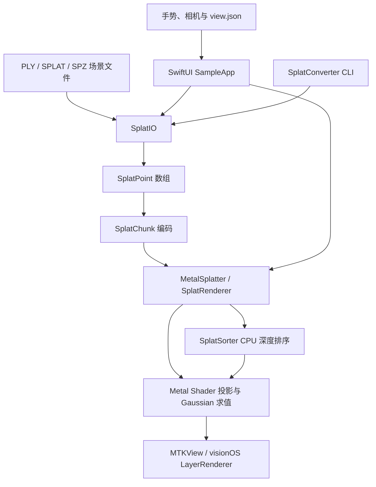
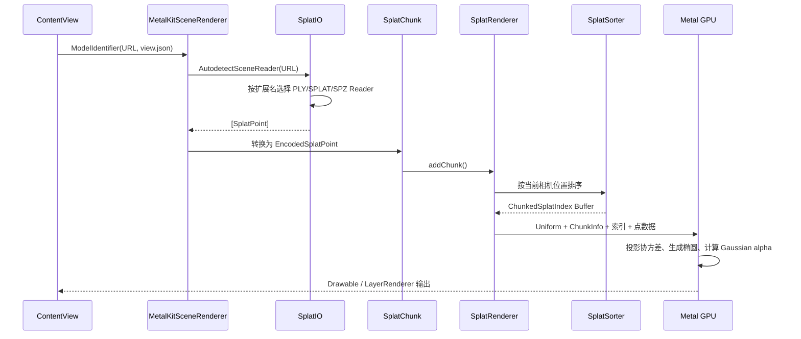

# MetalSplatter 代码架构与实现说明

> 适用工程：`MetalSplatter-macOS15-adapted`  
> 当前平台基线：Swift 6、macOS 15、iOS 18、visionOS 2  
> 当前默认场景：`bicycle500w`（4,868,799 个 Gaussian）

## 1. 文档目的

本文面向后续开发、性能优化、iOS 发布和新场景接入，说明工程的模块划分、数据结构、渲染管线、并发控制、跨平台实现及当前技术风险。

工程不是一个单体 App，而是“底层文件解析库 + Gaussian 场景语义库 + Metal 渲染库 + 示例应用 + 转换工具”的组合。核心渲染器本身不依赖 SwiftUI，可被其他 Metal/Swift 应用复用。

## 2. 总体架构



从职责上可分为六层：

| 层级 | 模块 | 主要职责 |
|---|---|---|
| 应用层 | `SampleApp` | 场景选择、相机、手势、窗口、iOS/macOS/visionOS 生命周期 |
| 渲染抽象层 | `ModelRenderer` | 统一 Gaussian 渲染器和示例立方体渲染器接口 |
| Gaussian 渲染层 | `MetalSplatter` | GPU 数据编码、排序、资源管理、Metal 管线与 Shader |
| 场景语义层 | `SplatIO` | 把 PLY/SPLAT/SPZ 转换成统一的 `SplatPoint` |
| 通用文件层 | `PLYIO` | PLY Header、元素、属性、二进制/文本流读写 |
| 工具层 | `SplatConverter` | 命令行格式转换、检查与子范围导出 |

## 3. Swift Package 组成

根目录的 `Package.swift` 使用 Swift 6 语言模式，最低平台为 iOS 18、macOS 15、visionOS 2。

### 3.1 产品

- `PLYIO`：通用 PLY 文件库。
- `SplatIO`：Gaussian Splat 场景输入输出库。
- `MetalSplatter`：核心 Metal 3DGS 渲染库。
- `SampleBoxRenderer`：用于验证相机和渲染接口的参考立方体。
- `SplatConverter`：格式转换命令行程序。

### 3.2 外部依赖

- `swift-argument-parser`：命令行参数解析。
- `spz-swift`：SPZ 压缩 Gaussian 格式支持。

渲染核心没有引入第三方图形引擎，直接使用 Metal、MetalKit、simd 和平台图形框架。

## 4. 目录结构

```text
MetalSplatter-macOS15-adapted/
├── Package.swift
├── PLYIO/                         通用 PLY 读写
├── SplatIO/                       Gaussian 场景格式层
├── MetalSplatter/
│   ├── Sources/                   Swift 渲染代码
│   └── Resources/                 Metal Shader
├── SampleBoxRenderer/             参考渲染器
├── SplatConverter/                命令行转换工具
├── SampleApp/
│   ├── App/                       App 入口
│   ├── Model/                     模型标识和渲染器抽象
│   ├── Scene/                     SwiftUI、MTKView、visionOS 场景
│   ├── Util/                      矩阵工具
│   └── Scenes/                    内置 PLY 与 view.json
├── package-ios.sh                 iOS 构建与导出脚本
├── verify-macos15.sh              macOS 适配验证脚本
└── Xcode-Performance-*.md          已有性能报告
```

## 5. 场景加载到屏幕显示的完整链路



### 5.1 场景选择

`ContentView` 管理内置场景和文件导入。当前默认模型是 `bicycle500w`。`ModelIdentifier` 将模型来源表示为：

- Gaussian 文件 URL，可附带 `SceneViewConfiguration`；
- 程序化 Gaussian；
- 示例立方体。

macOS 还支持通过 `--model` 参数覆盖默认文件，便于命令行测试。

### 5.2 格式自动识别

`AutodetectSceneReader` 按文件扩展名选择具体 Reader。上层不需要关心源数据来自 PLY、SPLAT 还是 SPZ，最终统一得到 `SplatPoint`。

### 5.3 CPU 语义对象

`SplatPoint` 是格式层和渲染层之间的标准结构，主要字段为：

- 三维位置；
- 颜色或球谐系数；
- opacity；
- 三轴 scale；
- rotation quaternion。

颜色支持普通 sRGB 和 0～3 阶球谐系数。PLY Reader 会把训练工具常见字段，例如 `x/y/z`、`f_dc_*`、`f_rest_*`、`scale_*`、`opacity`、`rot_*`，映射为上述统一语义。

### 5.4 GPU 编码

`SplatChunk` 将 `[SplatPoint]` 转成紧凑的 `EncodedSplatPoint`：

- position 保持 Float32；
- SH0 与 alpha 使用 Float16；
- scale 与 quaternion 在 CPU 上预计算为对称 3D covariance；
- covariance 只保存六个独立分量，并压缩为 Float16；
- 高阶 SH 存在独立 Float16 Buffer 中。

这样避免 GPU 每帧重复从 scale/quaternion 构建协方差，也降低点数据带宽。

## 6. PLYIO：通用文件解析层

`PLYIO` 与 Gaussian 算法无关。它实现：

- PLY Header、element、property 建模；
- ASCII、binary little-endian、binary big-endian；
- 标量属性和 list 属性；
- 异步缓冲输入输出流；
- Reader/Writer 及相应错误检查。

这一层只负责“正确读取 PLY 数据”，不解释属性是否代表位置、颜色或 Gaussian 参数。因此它也可以用于普通点云或网格 PLY。

设计价值是把文件语法与 3DGS 语义解耦：新 PLY 变体通常在 `SplatIO` 做字段映射，而不是修改底层字节解析器。

## 7. SplatIO：Gaussian 场景语义层

### 7.1 协议抽象

`SplatSceneReader` 和 `SplatSceneWriter` 定义统一场景读写协议。具体格式通过协议适配，使上层渲染器不依赖某一种磁盘格式。

目前支持：

- Gaussian PLY；
- `.splat`；
- SPZ。

### 7.2 PLY 字段转换

PLY Gaussian 数据通常来自不同训练管线，命名和排列约定并非 PLY 标准的一部分。`SplatIO` 负责：

- 查找必要属性；
- 将 opacity、scale 等训练空间数值转换成渲染语义；
- 组装 quaternion；
- 将 channel-major 的高阶球谐数据重排为渲染器使用的 RGB 交错布局；
- 处理缺失字段和不兼容格式。

### 7.3 当前内存行为

示例 App 使用 `readAll()` 一次性聚合整个模型，再创建 `SplatChunk`。对 486 万点模型，这会同时存在：

1. 文件读取缓冲；
2. 完整 `[SplatPoint]`；
3. 编码后的 Metal Buffer；
4. 排序索引与临时排序数据。

因此启动阶段的峰值内存明显高于稳定渲染阶段。这是后续优化中优先级很高的一项。

## 8. MetalSplatter：核心渲染框架

### 8.1 `SplatRenderer`

`SplatRenderer` 是核心公共入口，负责：

- 管理一个或多个 `SplatChunk`；
- 创建 Render Pipeline、Depth State 和 Shader Library；
- 维护多帧并行 Uniform Buffer；
- 触发和消费深度排序；
- 将每个 chunk 的 GPU 地址传给 Shader；
- 编码单阶段或多阶段绘制命令；
- 管理 CPU 修改和 GPU in-flight 访问之间的同步。

当前示例将最大并行帧数设为 3。渲染器最多支持两个 view，满足立体显示场景的设计需要。

### 8.2 Chunk 模型

一个场景可以由多个 `SplatChunk` 构成。Chunk 带来以下能力：

- 按区域或 LOD 增删点；
- 避免每次修改都重建全场景 Buffer；
- 为流式加载和空间分块预留接口；
- 用紧凑 chunk index 在 GPU 查找对应 Buffer。

`addChunk` 默认进行 Morton 空间局部性排序，使相邻空间点在内存中更接近，有利于缓存和连续访问。需要注意，这种局部性排序不等于透明混合所需的逐帧深度排序。

### 8.3 GPU Buffer 管理

`MetalBuffer<T>` 是带类型的 `MTLBuffer` 包装器，使用 shared storage，提供容量调整和受控指针访问。`MTLBufferPool` 对可复用 Buffer 做线程安全回收，减少频繁分配带来的抖动。

渲染过程中主要 Buffer 包括：

- 每点编码数据；
- 高阶 SH 数据；
- 排序后的 `ChunkedSplatIndex`；
- 每 chunk GPU 地址与元数据；
- 动态帧 Uniform；
- 多阶段路径使用的 tile/imageblock 数据。

### 8.4 深度排序

Gaussian 使用半透明 premultiplied alpha 混合，一般需要从后往前绘制。`SplatSorter` 的流程为：

1. 接收当前相机位姿；
2. 对每个点计算相对相机的距离指标；
3. 在 CPU 上执行稳定的从远到近排序；
4. 写入 `ChunkedSplatIndex` Metal Buffer；
5. Renderer 在下一次可用绘制中使用最新完整结果。

排序在高优先级 detached task 中运行，并使用多份索引 Buffer 与引用计数，避免 CPU 写入 GPU 正在读取的 Buffer。

复杂度近似为 `O(N log N)`。对 4,868,799 点来说，这是当前最大的 CPU 扩展性问题。当前 App 每帧还包含自动旋转，相机姿态持续变化，导致排序器几乎没有静止窗口，会不断重新排序整个 500 万点集合。

### 8.5 并发与生命周期

项目已适配 Swift 6 严格并发：

- UI 和 `MTKViewDelegate` 相关对象放在 `@MainActor`；
- `SplatRenderer` 内部使用 `Synchronization.Mutex` 管理访问状态；
- Render 编码、chunk 修改和 GPU in-flight 生命周期被显式协调；
- Command Buffer completion handler 归还帧信号量；
- 修改 chunk 时可等待现有 GPU 访问结束，避免悬空 Buffer 或数据竞争；
- 需要跨 actor 使用但内部已有同步保证的渲染器采用受控的 `@unchecked Sendable`。

`isReadyToRender` 在获取 drawable 之前检查渲染状态，避免无意义地占用 drawable 和帧资源。

## 9. Metal Shader 与绘制算法

### 9.1 顶点阶段

每个 Gaussian 在屏幕上表示为一个覆盖椭圆的四边形/三角形集合。Shader 主要执行：

1. 将三维中心变换到相机和裁剪空间；
2. 将 3D covariance 投影成 2D covariance；
3. 对 2D covariance 做特征分解；
4. 得到椭圆长短轴和屏幕包围范围；
5. 生成实例化几何顶点；
6. 根据视线方向计算球谐颜色。

渲染器只保留一个较小的基础索引集合，并通过实例化绘制大量 Gaussian，避免为数百万个 splat 保存重复三角形索引。

### 9.2 片元阶段

片元阶段计算椭圆局部坐标下的 Gaussian 权重，将其与 opacity 相乘，并进行 premultiplied alpha 输出。边缘处权重迅速衰减，形成连续的椭圆 splat，而非硬边四边形。

### 9.3 单阶段路径

单阶段路径直接使用标准顶点/片元管线和硬件 alpha blending 写入颜色目标。优点是结构简单、兼容性好、资源开销较小。

### 9.4 多阶段高质量深度路径

当启用 depth 和 high-quality depth，且设备能力允许时，渲染器使用 tile/imageblock 多阶段路径：

1. 初始化 tile/imageblock；
2. 绘制 splat，并在 tile 内自定义累计颜色和深度；
3. 后处理写回最终 attachment。

该路径可生成更合适的深度信息，尤其服务于 visionOS 重投影，但比普通颜色混合更复杂，也可能增加 iOS GPU 成本。

### 9.5 Shader 加载

在 Xcode/Swift Package 正常资源构建中，Shader 从 `Bundle.module` 的默认 Metal Library 加载。为支持某些 `swift build` 环境，代码还提供读取源码并运行时编译的回退路径。

## 10. SampleApp 应用层

### 10.1 App 和窗口

`SampleApp.swift` 使用 SwiftUI：

- iOS：单窗口 `NavigationStack`；
- macOS：主窗口，并可按模型打开独立窗口；
- visionOS：普通窗口加 `ImmersiveSpace`。

### 10.2 渲染器抽象

`ModelRenderer` 协议将应用层和具体渲染实现隔离。`SplatRenderer` 与 `SampleBoxRenderer` 分别提供适配扩展。这样相机、视图尺寸、渲染循环可以复用，而不必让 UI 直接依赖某个渲染类的全部 API。

### 10.3 MetalKit 桥接

`MetalKitSceneView` 分别通过 `NSViewRepresentable` 和 `UIViewRepresentable` 包装 `MTKView`。`Coordinator` 负责：

- 创建并持有 `MetalKitSceneRenderer`；
- 连接 MTKView delegate；
- 将平台手势转换成统一旋转/缩放输入；
- 允许旋转和缩放手势同时识别。

`MetalKitSceneRenderer` 运行在主 actor，负责：

- 加载模型与 view 配置；
- 创建 `SplatChunk`；
- 计算 view/projection matrix；
- 维护最大 3 帧并行信号量；
- 获取 command buffer、编码绘制并提交；
- 在 GPU 完成回调中释放帧槽位。

### 10.4 手势和相机

当前交互包括：

- 单指拖动：修改 yaw/pitch，实现手动旋转；
- 双指缩放：修改 FOV 缩放比例，范围约为 0.5～4；
- 自动旋转：以固定角速度持续更新 yaw；
- iOS 同时识别旋转与缩放手势。

最终 view matrix 由场景配置的相机平移、相机 quaternion、手动旋转和工程坐标系校准矩阵共同组成。

### 10.5 `view.json`

`SceneViewConfiguration` 包含：

- `position`：相机位置；
- `rotation`：按 `[w, x, y, z]` 保存的 quaternion；
- `fieldOfViewDegrees`；
- `nearZ`；
- `farZ`。

`bicycle500w` 当前复用了 `bicycle120w` 的相机配置，因此两者初始观察方向和裁剪范围一致。

## 11. visionOS 专用架构

visionOS 不使用普通 MTKView 作为沉浸式输出，而是使用 CompositorServices `LayerRenderer`。`VisionSceneRenderer` 负责：

- 启动 `ARKitSession` 和 `WorldTrackingProvider`；
- 获取设备 anchor 与预测姿态；
- 管理 LayerRenderer frame 生命周期；
- 为每个 view 填充对应相机矩阵；
- 在专用串行 DispatchQueue/TaskExecutor 上运行帧循环；
- 把 Gaussian 颜色和深度结果提交给系统合成器。

这也是核心渲染器支持最多两个 view 和高质量深度路径的主要原因。

## 12. SampleBoxRenderer 与程序化场景

`SampleBoxRenderer` 是轻量参考实现，用 MetalKit mesh 绘制立方体。其价值不在 3DGS，而在于：

- 验证设备、drawable、深度和相机矩阵是否正确；
- 展示 `ModelRenderer` 的最小实现；

- 当 Gaussian 数据出错时，用于区分“通用渲染环境故障”和“3DGS 数据/算法故障”。

`ProceduralSplatController` 演示动态增删 chunk 和不同 LOD，可作为后续流式场景管理的参考入口。

## 13. SplatConverter

`SplatConverter` 使用 ArgumentParser 提供命令行转换能力，包括：

- 在 PLY、SPLAT、SPZ 等支持格式间转换；
- 输出场景描述；
- 选取子范围；
- verbose 调试信息。

它复用 `SplatIO`，因此格式解释逻辑不会在 App 与命令行程序中重复。

典型构建方式：

```bash
swift build -c release --product SplatConverter
```

## 14. 内置场景与资源策略

当前 `SampleApp/Scenes` 包含：

| 场景 | 用途 |
|---|---|
| `bicycle500w` | 默认高负载真机性能场景，约 486.9 万点 |
| `bicycle120w` | 较轻的 bicycle 场景及相机配置来源 |
| `garden_images2_3k` | 极小规模功能验证 |
| `garden_images2_7k` | 小规模功能验证 |
| `garden_images2_30k` | 中小规模质量验证 |

当前所有场景作为 Bundle Resource 随 App 打包。优点是离线可直接测试；缺点是安装包约 2.1 GB，归档/传输慢，而且不适合作为正式上架方案。

正式产品更适合采用以下一种或多种方式：

- 首次运行后按需下载；
- On-Demand Resources 或自有资源服务；
- 使用 SPZ 等压缩格式；
- 只内置小型演示场景；
- 本地文件导入和缓存管理。

## 15. 当前 500 万点真机性能结论

既有 Xcode/真机测量结果：

| 指标 | 当前结果 |
|---|---:|
| 场景点数 | 4,868,799 |
| 平均 FPS | 约 19.5 |
| Metal submissions | 约 19.73 次/秒 |
| GPU 平均耗时 | 约 8.34 ms |
| GPU P95 | 约 51.12 ms |
| GPU 最大值 | 约 53.61 ms |
| Physical footprint 平均 | 约 1.126 GiB |
| CPU 使用率 | 约 5.16% |
| Thermal state | nominal |

这些数据表明：

- GPU 平均耗时并非始终超过一帧预算，但尾延迟明显；
- FPS 没有达到 60，且提交频率约 20/s；
- CPU 总利用率低不代表排序便宜，因为排序可能受单任务串行、内存带宽和同步节奏限制；
- 自动旋转造成相机持续变化，从而持续触发全量深度排序；
- 500 万点需要更适合大规模透明点云的排序/LOD/裁剪方案。

详细原始分析见工程中的 `Xcode-Performance-bicycle500w-iPhone.md`。

## 16. 主要技术风险与债务

### 16.1 全量 `readAll()` 导致加载峰值

当前先创建完整 `[SplatPoint]`，再编码完整 GPU Buffer。建议改为批量读取并逐 chunk 编码，使原始 Swift 对象可以尽快释放，同时显示加载进度。

### 16.2 CPU 全量排序扩展性不足

每次相机变化对数百万点做稳定排序，复杂度与内存流量都很高。建议按优先级评估：

1. 停止不必要的自动旋转，静止相机复用上次排序；
2. 设置位姿变化阈值，避免微小变化立即重排；
3. 屏幕外/背后 Gaussian 预裁剪；
4. 分块排序和块级粗排序；
5. LOD 与点数预算；
6. GPU radix sort 或近似 bucket sort；
7. 根据场景接受度评估 OIT/加权混合，降低严格全序依赖。

### 16.3 加载与编码可能影响主线程响应

`MetalKitSceneRenderer` 是 `@MainActor`，模型创建流程由它组织。即使文件读取包含 async suspension，大数组转换和 `SplatChunk` 编码仍可能在主 actor 上产生长时间工作。建议把纯数据解析和编码移至独立任务，只在主 actor 上安装已准备好的 chunk。

### 16.4 包体过大

500 万点 PLY 本身约 1.2 GB，加上其他场景后 App 约 2.1 GB。开发侧载可以接受，但分发、更新和用户存储成本过高。

### 16.5 错误与进度反馈不足

超大模型加载时间长，当前应用需要更明确的：

- 读取/解码/上传阶段进度；
- 可取消操作；
- 内存不足和格式错误提示；
- 模型元数据与点数展示；
- 首帧就绪状态。

### 16.6 配置校验

`view.json` 中位置和 quaternion 使用数组表达，建议在 decode 后验证数组长度、数值有限性、near/far 关系与 quaternion 范数，避免错误配置延迟到矩阵计算阶段才暴露。

## 17. 推荐优化路线

### 阶段 A：低风险、立即收益

- 增加自动旋转开关，性能测试默认关闭；
- 相机未发生足够变化时不触发排序；
- 加载期间显示阶段和进度；
- 使用 autorelease/明确生命周期及时释放 `[SplatPoint]`；
- Release 真机测试固定分辨率、固定相机路径和固定时间窗口。

### 阶段 B：加载与资源架构

- Reader 批量输出；
- 每批直接编码为 Chunk；
- 后台构建和主线程原子安装；
- SPZ 压缩与按需下载；
- 场景缓存、版本和校验和管理。

### 阶段 C：大场景渲染

- 视锥裁剪；
- 空间分块及块级排序；
- 基于投影尺寸的 LOD；
- 每帧点数预算；
- GPU 排序或近似透明算法；
- Instruments 中分别标记读取、编码、排序、等待和 GPU 阶段。

## 18. 常见扩展方式

### 18.1 添加新场景

1. 在 `SampleApp/Scenes/<scene-name>/` 放入 `point_cloud.ply`。
2. 放入同目录 `view.json`，或复用相近场景配置。
3. 在 Xcode target 的 Resources 中确认文件夹被包含。
4. 在 `ContentView` 的内置场景列表注册。
5. 若设为默认场景，修改默认 `ModelIdentifier`。
6. 在真机 Release 配置下验证首帧、内存、FPS 和裁剪面。

### 18.2 添加新文件格式

1. 在 `SplatIO` 实现 `SplatSceneReader`/`Writer`。
2. 将源格式字段转换为 `SplatPoint`。
3. 在自动识别器注册扩展名。
4. 为边界、损坏文件和 round-trip 增加测试。
5. `MetalSplatter` 通常无需修改。

### 18.3 添加新手势

1. 在 `MetalKitSceneView` 的平台 Coordinator 中捕获手势。
2. 将输入转换成与平台无关的相机状态。
3. 在 `MetalKitSceneRenderer` 统一生成 view/projection matrix。
4. 对影响相机位姿的操作考虑排序触发频率。

### 18.4 替换渲染后端

如需加入其他调试渲染器，可实现 `ModelRenderer`，复用现有 SwiftUI、MTKView 和相机组织方式。若需要不同的 drawable/depth attachment，则还需扩展 view 配置和帧编码接口。

## 19. 构建、测试与打包

### 19.1 Swift Package 测试

```bash
swift test
```

### 19.2 macOS Release

在 Xcode Scheme 中选择 `My Mac`，将 Run 的 Build Configuration 设为 `Release` 后运行。也可使用工程提供的 `verify-macos15.sh` 做命令行验证。

### 19.3 iOS

使用 `SampleApp/MetalSplatter_SampleApp.xcodeproj`，选择已签名 Team、真机目标和 Release 配置。`package-ios.sh` 封装了 simulator、archive 和 IPA 导出流程；真机安装仍依赖有效签名与设备信任关系。

### 19.4 性能测试原则

- 使用 Release，不使用 Debug；
- 使用真机，不以 Simulator 判断 GPU 性能；
- 固定场景、视角、屏幕刷新率和测试时长；
- 分开测“关闭自动旋转的静态相机”和“持续运动相机”；
- 同时记录 CPU、GPU、内存、帧时间 P95/P99 和 thermal state；
- 首次加载与稳定渲染分开统计。

## 20. 关键代码索引

| 文件 | 作用 |
|---|---|
| [`Package.swift`](Package.swift) | 模块、依赖和平台定义 |
| [`SplatIO/Sources/SplatPoint.swift`](SplatIO/Sources/SplatPoint.swift) | Gaussian 标准 CPU 数据模型 |
| [`SplatIO/Sources/AutodetectSceneReader.swift`](SplatIO/Sources/AutodetectSceneReader.swift) | 场景格式自动识别 |
| [`MetalSplatter/Sources/SplatRenderer.swift`](MetalSplatter/Sources/SplatRenderer.swift) | 核心 Renderer 与绘制编码 |
| [`MetalSplatter/Sources/SplatChunk.swift`](MetalSplatter/Sources/SplatChunk.swift) | Chunk 与 GPU 点编码 |
| [`MetalSplatter/Sources/SplatSorter.swift`](MetalSplatter/Sources/SplatSorter.swift) | CPU 深度排序与索引 Buffer 生命周期 |
| [`MetalSplatter/Sources/MetalBuffer.swift`](MetalSplatter/Sources/MetalBuffer.swift) | 泛型 MTLBuffer 管理 |
| [`SampleApp/Scene/ContentView.swift`](SampleApp/Scene/ContentView.swift) | 场景列表、默认模型和文件导入 |
| [`SampleApp/Scene/MetalKitSceneView.swift`](SampleApp/Scene/MetalKitSceneView.swift) | MTKView 的 SwiftUI 桥接和手势 |
| [`SampleApp/Scene/MetalKitSceneRenderer.swift`](SampleApp/Scene/MetalKitSceneRenderer.swift) | macOS/iOS 渲染循环、加载和相机 |
| [`SampleApp/Scene/VisionSceneRenderer.swift`](SampleApp/Scene/VisionSceneRenderer.swift) | visionOS 合成、追踪与双视图渲染 |
| [`SampleApp/Model/ModelRenderer.swift`](SampleApp/Model/ModelRenderer.swift) | 应用层渲染器协议 |
| [`SampleApp/Model/ModelIdentifier.swift`](SampleApp/Model/ModelIdentifier.swift) | 模型来源与 view 配置 |
| [`SplatConverter/Sources`](SplatConverter/Sources) | 场景转换命令行程序 |

> 某些源码文件的实际名称可能进一步按功能拆分；以当前工程目录和 Xcode Project Navigator 为准。

## 21. 架构结论

当前工程的优点是层次清晰：PLY 字节解析、Gaussian 语义、GPU 渲染和平台 UI 已较好解耦；渲染核心可作为 Swift Package 复用；Swift 6 并发和 macOS/iOS/visionOS 三平台也已有统一基础。

对普通规模场景，现有结构已经具备完整加载和渲染能力。面向 500 万点及更大场景，下一阶段重点不应是继续堆叠 UI 功能，而应转向“流式加载、分块/LOD、降低全量排序频率、资源按需分发和可复现性能度量”。其中，持续自动旋转触发全量 CPU 排序，是当前最直接且容易验证的性能影响因素。
