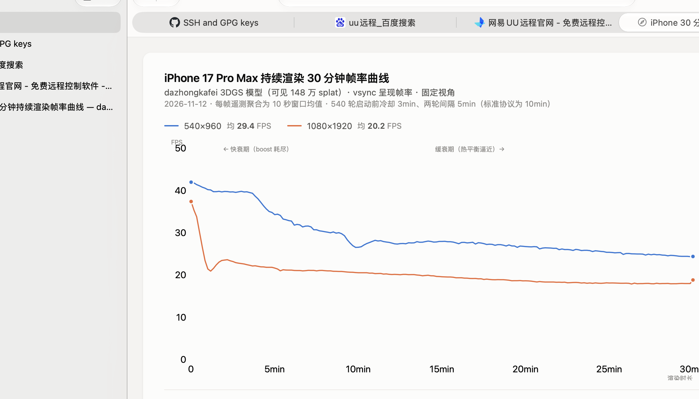

# iPhone 30 分钟持续负载测试（540×960 / 1080×1920 vsync）

> 附属于 [REPORT.md](REPORT.md)。测试日期 2026-11-12。
> 目的：长时间（30min）渲染下帧率、CPU encode、热节流的演变曲线；对比两种分辨率模式的负载稳定性。

## 测试方法

- 设备：iPhone 17 Pro Max（iOS 27.2，USB 有线，屏幕保持点亮，app 前台固定视角）
- app：Release 构建，vsync 渲染循环，`--perf` 每帧遥测（时间戳、encode 分解、splat 数）
- 流程（每轮）：冷却 → devicectl 启动（固定视角）→ 连续渲染 30min → 终止（CSV flush）→ 拉取 → 终止后 10s 内热尾 `--benchmark-frames=100`（离屏 100 帧，测热态单帧耗时 vs 冷态基线）
- **冷却协议**：标准为每组之间静置 **10min**（无风扇机型满载后热残留深）。本轮 540 启动前有 ~3min 冷却、540→1080 间隔 5min（指示下达前排队）——1080 前 3min 25.6 FPS 基本恢复冷态（26.2），但 540 的深层热残留可能使其中期衰减略偏快，跨轮对比斜率时需留意
- 静态视角渲染路径与此前分析一致：GPU 每帧全量重画、CPU 排序零触发（splat_count 从 2.0M 在第 6 帧起恒定 1,482,523，全程无重排）

### 工具链说明（为何用 app 内置遥测而非 Instruments）

- Game Performance Overview / Activity Monitor 模板经 `xctrace record --device --launch` 在 iOS 真机上无数据产出（空 trace，仅 RunIssues.storedata）
- Metal System Trace 可用（昨天 20s 录制成功，含 `device-thermal-state-intervals` 热状态表，20s 内全程 Fair），但 `--launch` 与 app 参数传递互斥：`--perf=...` 被吞（app 回落默认文件名 perf.csv）、且 app 渲染 ~100s 后被 Instruments 会话挂起
- 结论：30min 曲线用 app 内置 PerfRecorder（每 120 帧原子重写 CSV）；热状态用**帧率衰减曲线 + 热尾 benchmark**间接表征（帧率下降即节流的直接观测）

## 帧率变化曲线

**[打开交互版曲线图 →](data/support/fps-curve-30min.html)**（`data/support/fps-curve-30min.html`，浏览器打开：悬停十字线读取任意时刻两轮帧率、底部每 5 分钟数据表、浅色/深色自适应。曲线为 10 秒窗口均值，共 181 点/轮。静态快照如上图。）

**曲线特征**：两条曲线同构——前 ~8 分钟陡降（boost 高频耗尽 + 结构件升温），随后以 ≈0.2 FPS/min（540）/ 0.15 FPS/min（1080）缓降，30 分钟末仍未水平（热平衡未完全到达）。540 全程高于 1080 约 8-11 FPS，间距随时间略收窄（两轮热衰减斜率不同，1080 后段掉得更慢是因帧长已深入 3-4 个 vsync 拍）。

## 结果总览

| 指标 | 540×960 | 1080×1920 |
|---|---:|---:|
| 总帧数 / 30min | 53040 | 36360 |
| 平均 FPS | **29.4** | **20.2** |
| 启动冷态 FPS | 41.4 | 26.2（冷冲刺前 20s 36.5） |
| 末 5min FPS | **24.9** | **18.1** |
| 总衰减 | 39→25（−37%） | 26→18（−31%） |
| 热尾 100 帧离屏 | 30.5ms/帧 | 48.5ms/帧 |
| 热尾 vs 冷态基线 | 19.1→30.5ms（**+60%**） | 25.0→48.5ms（**+94%**） |
| CPU encode 漂移 | 0.074→0.098ms（+33%） | 0.090→0.107ms（+18%） |

（冷态基线 = 2026-11-11 冷却 60s+ 后测得：540 离屏 19.11ms、1080 离屏 25.0ms。）

## 分钟级曲线

### 540×960

| min | FPS | 帧间隔p50 | p95 | encode |
|---|---|---|---|---|
| 0-3 | 39.5-41.4 | 25.0ms | 30-33ms | 0.073ms |
| 4-7 | 30.9-36.3 | 26-29ms | 50-59ms | 0.078-0.088ms |
| 8-10 | 27.3-30.1 | 39-50ms | 59-68ms | 0.088-0.093ms |
| 11-15 | 27.5-28.0 | 50-51ms | 67ms | 0.092ms |
| 16-20 | 26.7-27.7 | 42-55ms | 67-71ms | 0.094ms |
| 21-25 | 25.3-26.4 | 55-56ms | 72-76ms | 0.096ms |
| 26-30 | 24.5-25.1 | 56-60ms | 76ms | 0.097-0.099ms |

分段：前 5min **39.4** → 5-15min 29.3 → 15-25min 26.8 → 末 5min **24.9 FPS**

### 1080×1920

| min | FPS | 帧间隔p50 | p95 | encode |
|---|---|---|---|---|
| 0 | 31.2（含冷冲刺 36.5） | 29ms | 50ms | 0.088ms |
| 1-3 | 22.2-23.4 | 42-45ms | 67-71ms | 0.090-0.094ms |
| 4-10 | 20.6-22.0 | 46ms | 70-76ms | 0.094-0.097ms |
| 11-15 | 19.6-20.4 | 50ms | 76-79ms | 0.099-0.103ms |
| 16-20 | 18.6-19.4 | 50ms | 80-83ms | 0.101-0.103ms |
| 21-25 | 18.2-18.4 | 54ms | 83-84ms | 0.104-0.105ms |
| 26-30 | 18.0-18.1 | 54ms | 84-88ms | 0.106-0.108ms |

分段：前 5min **24.2** → 5-15min 20.7 → 15-25min 18.8 → 末 5min **18.1 FPS**

## 分析

### 1. 两轮都呈"两段式"衰减

- **快衰期（0-8min）**：boost 高频用尽、结构件升温，帧率快速下台阶（540: 41→30；1080: 26→21）
- **缓衰期（8-30min）**：热平衡逼近，帧率缓慢线性下滑（540: 30→25，斜率 ≈ −0.2 FPS/min；1080: 21→18，≈ −0.15 FPS/min），30min 时仍未完全饱和（末段仍在微降）

### 2. 1080 热衰减比 540 更深

热尾离屏单帧耗时（剥离 vsync 量化的真实 GPU 帧长）：
- 540：19.1 → 30.5ms（**+60%**）
- 1080：25.0 → 48.5ms（**+94%**）

更高分辨率负载的功耗更大，节流幅度也更大——**热衰减程度与负载强度正相关**，不是简单的统一降频。

### 3. 帧率数字的读法（vsync 量化掩盖了真实 GPU 变慢幅度）

- 540 帧长 p50 从 25ms→60ms（+140%），但帧率只从 41→25（−37%）：因为帧长跨越 vsync 拍数（1→3 拍），量化把连续变慢"量化"成台阶
- 1080 帧长 p50 41→54ms（+32%），帧率 26→18（−31%）：本就 3 拍，帧长增加直接换算成掉帧
- **比较热变慢的实质请用热尾数字（+60% / +94%），比较用户观感用帧率曲线（−37% / −31%）**

### 4. CPU 侧同步变慢但非主因

encode 从 0.074→0.098ms（540，+33%）/ 0.090→0.107（1080，+18%）：CPU 性能簇同被降频，但绝对值仍 ~0.1ms/帧（<0.5% 帧预算），瓶颈依旧是 GPU 顶点阶段（与 Bottleneck-Analysis 结论一致，热态下进一步放大）。

### 5. 实用结论

- **540 长时间观看可用**：30min 后仍有 25 FPS（人眼可接受的下限附近），衰减主要发生在前 8 分钟
- **1080 持续渲染不可用**：冷态 26 起步、热态 18 FPS 且 30min 未饱和
- 任何"热态基准"性能主张应注明预热时长；本数据提供了 0→30min 的完整衰减基线
- 若产品需长时间渲染，可考虑：功耗自适应（检测热状态后降 SH 阶数/分辨率）——540 热稳态 25 FPS 意味着热预算内 GPU 只剩 ~60% 吞吐

## 数据文件

- `data/sustained/ios-540.csv` — 540×960 30min 每帧遥测（53040 行）
- `data/sustained/ios-1080.csv` — 1080×1920 30min 每帧遥测（36360 行）
- 热尾结果见本文表格（BENCH-RESULT 原始行存于运行日志）
- `fps-curve-30min.png` — 帧率曲线静态图（本文插图）
- [`data/support/fps-curve-30min.html`](data/support/fps-curve-30min.html) — 帧率曲线交互版（crosshair/tooltip/数据表/深色模式）
